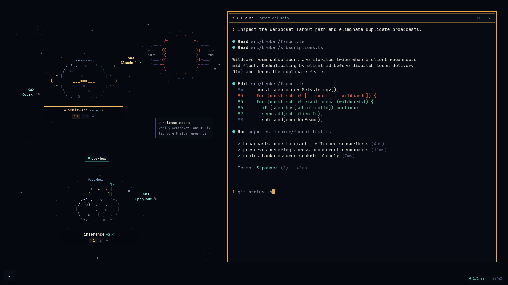

# Orrery

A custom dark spatial desktop layout for [Herdr](https://herdr.dev).



Spaces sit in a pannable, zoomable ASCII cosmos with orbiting agent spacecraft, floating markdown notes, resizable terminal/app windows, multi-machine SSH management, and a full-screen multi-pane focus mode.

## Features

- **Spatial canvas**: Drag empty space to pan, scroll to zoom out (`30%`–`100%`) with live `hc read` terminal snapshots, double-click space to reset.
- **Floating windows**: Draggable, 8-way border/corner resizable terminals, Files, Git Changes, Fleet Monitor, and Markdown notes. `Ctrl+Scroll` on a titlebar, border, or zoomed-out card scales that window. Manual tiling on demand (`Alt+T`).
- **Spaces & SSH machines**: Spaces render as ASCII planetoids with inline tabs and status indicators. Remote SSH hosts appear as grouped star systems, with an integrated machine picker when creating a new Space and full management in Fleet Monitor (`Alt+F`).
- **Notes**: Right-click anywhere in space → `Drop Note Here` (or `Alt+N`) to place a note at that spot; click to edit, drag to move.
- **Focus mode (`Alt+O`)**: Switches to native full-screen multi-pane splits with a compact topbar and collapsible Files/Changes drawers.

## Install

```sh
git clone https://github.com/jesperls/Orrery.git
cd Orrery

# Verify mods
herdr-app check ./mods/orrery
herdr-app check ./mods/orrery-toast
herdr-app check ./mods/orrery-menu

# Copy into Herdr config
mkdir -p ~/.config/herdr-app/{layouts,themes,mods}
cp layouts/orrery.json layouts/orrery.svg ~/.config/herdr-app/layouts/
cp themes/orrery.json ~/.config/herdr-app/themes/
cp -r mods/orrery mods/orrery-toast mods/orrery-menu ~/.config/herdr-app/mods/

# Activate
herdr-app do layout.switch '{"name":"orrery"}'
```

## Keybindings

Merge [keys.json](keys.json) into `~/.config/herdr-app/keys.json`:

| Shortcut | Action |
| --- | --- |
| `Alt+Space` | Toggle `≡` menu |
| `Alt+O` | Toggle cosmos / full-screen focus mode |
| `Alt+T` | Tile open windows |
| `Alt+M` | Show / restore desktop |
| `Alt+F` | Toggle Fleet Monitor |
| `Alt+E` | Toggle Files |
| `Alt+G` / `Ctrl+Shift+G` | Toggle Git Changes |
| `Alt+N` | Open or drop a note |
| `Alt+-` / `Alt+=` / `Alt+0` | Zoom cosmos out / in / reset |
| `Alt+Up` / `Alt+Down` | Previous / next agent (by urgency) |

Press `Ctrl+Alt+Shift+Escape` at any time to reset Herdr back to the default layout.
