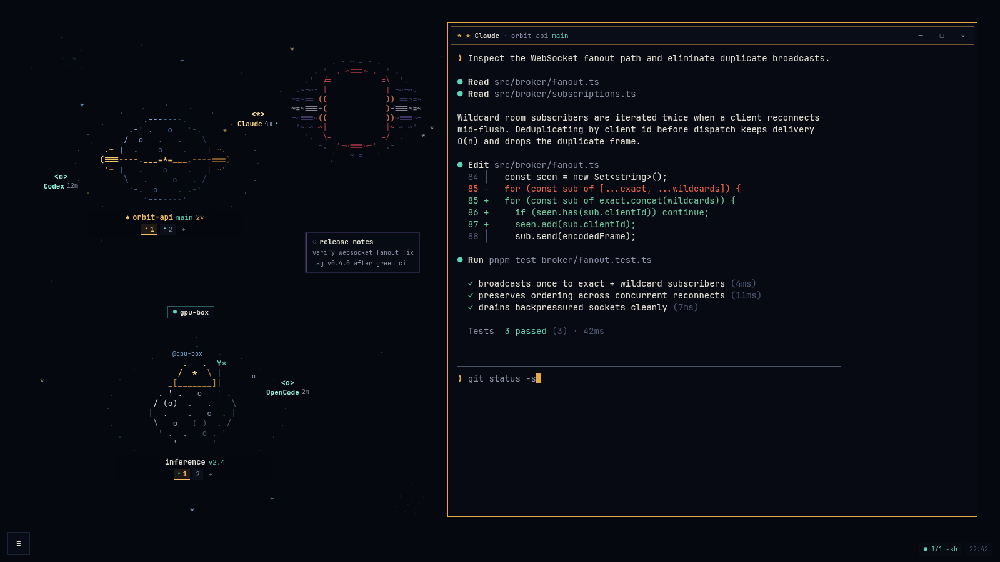

# Orrery

Repository: `https://github.com/jesperls/Orrery`

A **full-bleed infinite spatial cosmic desktop** Herdr layout (`orrery` dark obsidian) with scroll-to-zoom spatial overview (`30%`–`100%`), `Ctrl`/`Cmd+Scroll` per-window scaling, a live timer-driven Cosmic-Horror Event Director, first-class multi-machine SSH management with an integrated `New Space` machine selector, sculpted ASCII Space planetoids, continuously orbiting Agent spacecraft, minimal obsidian field notes in space, always-on-top `≡` corner trigger & popup menus, and free-floating 8-way border/corner resizable windows.

## Spatial Architecture
- **Root (`stack`, `active: "cosmos"`, no `header`, `titlebar: "none"`, `radius: 0`, `JetBrains Mono`)**:
  - **`cosmos` (`block`, `role: "universe"`)**:
    - Unified world-space projection `(wx * z + camX, wy * z + camY)` across every layer (`ascii.js`, `cosmos.js`, `director.js`): multi-LOD tiled starfield & distant clusters, unstable reality-flicker stars, binary star pair, pulsar beacon, wandering Singularity, dynamic Void Eyes, Spacetime Tears, Creeping Tendrils, Passing Wraiths, Obelisk Halo, and Reactive Cosmos Entropy when any agent is `blocked`.
    - Orbital plane: sculpted Space planetoids with moons & inline `[1] 2 +` tabs (per-tab status dots + tooltips), remote SSH star-system beacons linking remote Spaces by machine, orbiting Agent spacecraft + Sub-agent probes, and minimal obsidian Note cards.
    - Pure in-memory 60fps camera panning & proportional scroll-zoom (`30%`–`100%`, trackpad horizontal swipe / Shift+Scroll pan) clamped strictly to world bounds (`getWorldBounds`), with full-screen drag capture shield, double-click recenter, and persisted camera restoration on reload.
    - Spatially coherent zoomed terminals: live native Herdr overlays mount at `100%` zoom (`z >= 0.995`); below `100%`, windows render as pixel-matched absolute-grid cards using frozen pre-zoom `(lines, cols, rows)` snapshots (`hc read` + `hc get`) with direct zoomed-out keyboard typing (`hc keys` FIFO queue).
    - Barless full-bleed viewport: zero bottom taskbar; bottom-left `36×36` `≡` orb (`menubtn.js`) + minimal translucent bottom-right whisper HUD (`! N` blocked jump, zoom/reset, `● N/M ssh`, `tile`, `HH:MM` clock, optional app window buttons).
  - **`focus` (`column`)**:
    - **`topbar` (`block`, `28px`, `window_drag: true`, `role: "topbar"`)**: `cosmos` return button, macOS traffic-light-safe padding, Space & `+machine` switcher + branch, tabs, space-scoped `+` new tab, `! N` blocked jump, `+agent`, `fleet`, `files`, `changes`, `settings`, and `─ □ ×` window buttons.
    - **`focus-body` (`row`, `weight: 1`)**:
      - **`main` (`block`, `weight: 1`)**: Active-tab terminal panes (`gap: 4`, `radius: 0`, `1px` border/accent focus) with `22px` headers (`role: "pane"`).
      - **`side-drawer` (`stack`, `320px`, `200–560px`, `hidden: true`, `active: "side-files"`)**: Swaps between `files` and `changes`.
- **Always-On-Top `≡` Orb & `kind: "popup"` Menus (`menubtn.js`, `launcher.js`, `ctxmenu.js`)**:
  - `menubtn` (`36×36` non-draggable bottom-left `kind: "window"` overlay, `keep: false`) re-raises above floating windows on every window open/tile/focus return and closes cleanly in `focus` mode.
  - `launcher` (`kind: "popup"`) lists open windows (jump-to-world-window or close), Spaces (focus, `+` terminal, `×` close), integrated `+ New Space` machine selector, `+ Add Machine...`, New Terminal & inline `+ Agent` launchers, and Desktop Apps / actions.
  - `ctxmenu` (`kind: "popup"`) supports `space`, `machine`, `new-space`, `desktop`, `note`, and `taskbar` (window menu via right-click on titlebars or scaled world cards).
- **Native 8-Way Border & Corner Resizable Floating Windows (`openOverlay({ kind: "window", frame: "none", keep: false, ... })`)**:
  - 3×3 border layout (`5px` hairline `edge` strips + `14×14` L-shaped corner zones, `resizable: false` containers) driving the full-screen transparent 60fps wireframe `resizer` overlay (`mode: "move"` with 4px titlebar drag threshold, or `mode: "resize"` across `n | s | e | w | ne | nw | se | sw`).
  - Free-float + desktop cascade by default; manual `tileAllOpenWindows()` arranges 1, 2 (50/50), 3 (52/48 master+stack), or 4+ (balanced `NxM` grid) on demand.
  - `toggleShowDesktop()` stashes open terminals (with full geometry), tools, and Note windows to `shared("orrery.desktopStash")`, minimizes all, and restores cleanly on second toggle.
- **First-Class Multi-Machine SSH Management (`state.js`, `main.js`, `fleet.js`)**:
  - Polls `hc(["machine", "ls", "--json"])` at startup (~300ms) and every 15s (filtering out `m.temporary`, guarding stale responses), merging with live `machines()` layout readiness and `spaces()`.
  - `Fleet Monitor` (`views/fleet.js`) works in both Cosmos and Focus modes, providing `MACHINES`, machine-grouped `SPACES`, urgency-sorted `AGENTS`, `SUB-AGENTS`, and `SHELLS & TERMINALS`.

## Authority & Discipline
- **Live layout-derived mode**: `isFocusMode()` and `activeSideDrawer()` derive strictly from `layout()` and are never persisted in `shared()`.
- **Active-mode guarded authority (`universe` + `topbar`)**: 4s urgency/prune/cwd loop, 15s throttled git + SSH machines poll, 30s clock tick on `universe`, coalescing bounded action queue (`drainPendingCosmosActions`), startup overlay reconciliation (`reconcileOverlaysOnMount`), and `nextCommand()` dispatcher for `toggle-launcher`, `run-action`, `tile-all`, `minimize-all`, `toggle-mode`, `open-files`, `open-changes`, `open-fleet`, `open-notes`, `zoom-out`, `zoom-in`, `zoom-reset`.
- **Clean native resource cleanup**: `notes` creates `EditorState` in `init()`, flushes pending debounced edits on blur and in `close()`, calls `.release()` on editors and focus handles, clears overlay IDs on `close()`, and cancels all timers cleanly.

## Built From
- `layouts/orrery.json` + `layouts/orrery.svg`
- `themes/orrery.json`
- `mods/orrery/` (`mod.json`, `main.js`, `state.js`, `ascii.js`, `cosmos.js`, `director.js`, `views/{universe,menubtn,launcher,ctxmenu,winbar,toolwin,edge,resizer,fleet,notes,topbar,pane}.js`)
- `mods/orrery-toast/` + `mods/orrery-menu/`
- `keys.json` (`layout:orrery`)

## Done When
- All JSON files parse cleanly and `node --check` passes on all `.js` files.
- `herdr-app check` passes headless with exit code 0 on `./mods/orrery`, `./mods/orrery-toast`, and `./mods/orrery-menu`.
- Zero `"transparent"`, bare numeric `.line_height(N)`, `.rounded*`, synchronous `cx.notify()` in `init()`, stashed `cx`, or invalid `run("agent.pin")` calls.
